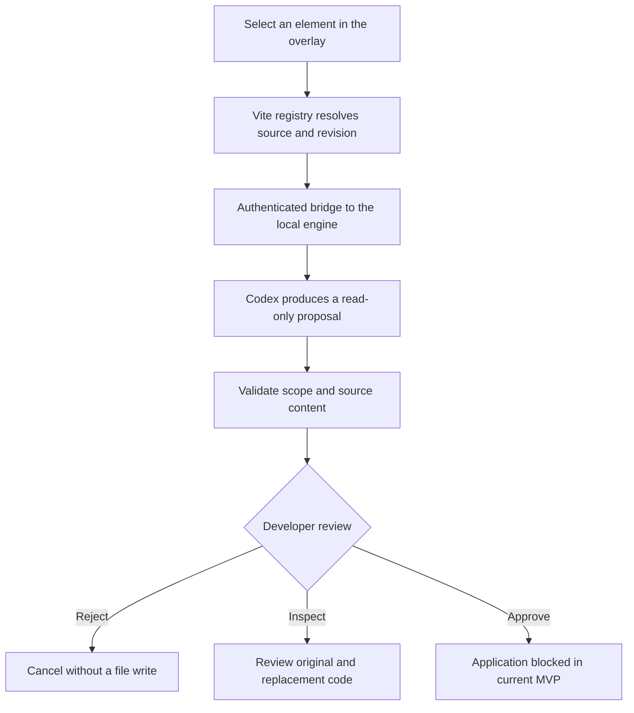

<div align="center">

# ⚡ Summon Fixer

### Point at the problem. Describe the change. Review the code.

**A visual, source-aware AI companion that brings Codex into your running website.**

[See the experience](#the-experience) · [How it works](#how-it-works) · [Run locally](#run-locally) · [Roadmap](#where-were-going)

**React + Vite · TypeScript · OpenAI Codex CLI · Local development**

</div>


<p align="center"><sub>Actual application screenshot: Aura Studio is our demo storefront; Summon Fixer is the development companion attached to it.</sub></p>

> **Hackathon MVP:** Select a live UI element, resolve its source, request a Codex proposal, and review the original and replacement code. Automatic file application is not enabled yet.
>
> **Looking for the runnable project?** Use **[integration/vertical-slice](https://github.com/GODLIKEyp/Summon-Fixer-/tree/integration/vertical-slice)**. The default `main` branch contains the earlier foundation and this project showcase.

## The idea

You can see the problem. Finding the code behind it is the slow part.

A checkout button needs a new design. A cart control does nothing. A form accepts an invalid email. Each task starts in the browser, then sends you through components, styles, event handlers, and AI chat before you can even explain what needs to change.

**What if the website itself was your starting point for working on its code?**

Summon Fixer connects a visible element to its source and carries that context into a Codex request. You describe the outcome in plain English and inspect a concrete source proposal from the same development surface.

### Who it is for

| Audience | Everyday friction | What Summon Fixer explores |
|:--|:--|:--|
| Developers | Switching between browser, editor, and AI chat | Starting a source-aware request from the actual UI |
| Creators | Explaining exactly which part of a page needs attention | Pointing at an element and describing the intended change |
| Local-business teams and their developers | Turning storefront feedback into implementation tasks | A shared visual reference and an inspectable code proposal |

The current prototype targets **local React/Vite development**. Broader creator and business workflows are the product direction.

## The experience

### 1. Point at what needs to change

Open the floating launcher or press **⌘⇧S** on macOS. Hover over an element and select it. Development-time instrumentation resolves the selection to its source location.

<p align="center">
  
</p>

<p align="center"><sub>Actual screenshot: the selected button maps to <code>App.tsx</code>. Line numbers vary by revision.</sub></p>

### 2. Say what you want

The overlay keeps the selected target and source badge beside your instruction. Choose **Manual Approval** for a reviewable proposal or **Plan Only** for a read-only task.

<p align="center">
  
</p>

<p align="center"><sub>Actual screenshot: the instruction panel. Auto Apply is disabled.</sub></p>

For example:

> Change this Checkout Now button to “Buy Now”, keeping the calculated price. Make it purple with white text and rounded corners. Preserve its checkout behavior.

### 3. Review a source-level proposal

The local runner invokes **OpenAI Codex CLI** in read-only mode and requests structured source changes. It validates the response against the proposal schema, allowed target, and existing source snippets before presenting the original and replacement code.

Review the proposal, reject it, or use the read-only result to guide your own edit. The team's earlier local browser verification reported a real Codex proposal and successful rejection; deterministic `--fake` output is a separate testing mode.

**Current application boundary:** approving a proposal does not modify files. The writer returns `SAFE_WRITE_UNAVAILABLE`. Applied changes and automatic hot reload remain future work.

## Three tasks to try

Our Aura Studio storefront provides realistic scenarios across styling, behavior, and validation. Checkout is simulated; no payment is processed.

| Scenario | Example request | What to inspect in the proposal |
|:--|:--|:--|
| **Visual design** | “Rename Checkout Now to Buy Now and make it purple.” | Label, styling, and preserved click behavior |
| **Cart behavior** | “Make the cart + and − buttons update quantity, totals, and tax.” | State updates, minimum quantity, and independent cart items |
| **Form validation** | “Block invalid checkout email and show an accessible error.” | Validation before processing, feedback, and preserved cart state |

The cart and validation defects are intentional demo fixtures. These scenarios demonstrate requests and proposal review; they are not claims of automatically applied fixes.

See the [scenario prompts and intended acceptance criteria](https://github.com/GODLIKEyp/Summon-Fixer-/blob/integration/vertical-slice/apps/demo/DEMO_SCENARIOS.md). Its apply/HMR steps describe the intended end-to-end target; the current writer still blocks application.

## How it works



The browser supplies a selection and request; the engine owns workspace and policy decisions. The model proposes changes rather than directly editing the project.

### Engineering choices

| Choice | Why it matters |
|:--|:--|
| **Source mapping through JSX/TSX instrumentation** | Connects a rendered element to registered source context |
| **Shadow DOM overlay** | Isolates the companion's interface from host-page styling |
| **Same-origin bridge and loopback engine** | Keeps the development connection local and authenticated |
| **Structured proposals and exact snippet checks** | Makes suggested changes inspectable and rejects malformed proposals |
| **Version- and digest-bound approvals** | Binds review decisions to a specific proposal |
| **Fail-closed writer** | Refuses file replacement while its concurrency guarantees are unresolved |

Read the [safe-write assessment](https://github.com/GODLIKEyp/Summon-Fixer-/blob/integration/vertical-slice/packages/runner/SAFE_WRITE_ASSESSMENT.md) for the current implementation boundary.

### Stack and repository map

| Location on the integration branch | Technology and responsibility |
|:--|:--|
| `apps/demo/` | React, TypeScript, Vite — Aura Studio and demo scenarios |
| `packages/overlay/` | Browser UI, element selection, prompts, and proposal review |
| `packages/vite-plugin/` | Dev-only injection, JSX transformation, source registry, and bridge |
| `packages/runner/` | Node.js and Codex CLI — proposal generation and task lifecycle |
| `packages/contracts/` | TypeScript and Zod — shared schemas, validation, and approval digests |
| `packages/cli/` | Local engine and development-server launcher |

## Run locally

**Requirements:** Node.js **24+**, npm **10+**, and two available local ports. Real AI generation also requires an installed, authenticated Codex CLI with available usage.

Clone the **integration branch**, which contains the complete runnable prototype:

```bash
git clone --single-branch --branch integration/vertical-slice https://github.com/GODLIKEyp/Summon-Fixer-.git
cd Summon-Fixer-
npm ci
npm run build
```

### With real Codex

```bash
codex --version
codex login status

CODEX_BIN_PATH="$(command -v codex)" npm run summon -- dev \
  --port 7890 \
  --proposal-timeout-ms 120000 \
  --command "npm run --workspace demo dev -- --host 127.0.0.1 --port 5185 --strictPort"
```

Open **[127.0.0.1:5185](http://127.0.0.1:5185)**, activate Summon Fixer, select an element, and submit a request. Review the returned source proposal. The model follows your local Codex configuration; authorized project context may be sent to its configured provider and consume usage.

### Without model calls

```bash
npm run summon -- dev --fake --port 7890 \
  --command "npm run --workspace demo dev -- --host 127.0.0.1 --port 5185 --strictPort"
```

`--fake` uses a deterministic test runner to exercise the interface and request pipeline. Its proposals are **not generated by Codex**. Omit this flag for real AI generation.

If either port is occupied, use an available port. Keep the app and engine on loopback. Stop with **Ctrl+C**.

### Development checks

```bash
npm run build
npm run typecheck
SUMMON_RUN_REAL_CODEX_TESTS=0 npm test
npm audit
git diff --check
```

The test command above excludes real-Codex integration tests. Build and unit-test success alone do not establish real-model or browser acceptance.

## Where we're going

**Our vision: use the running interface to request, review, and verify changes to the software behind it.**

The storyboard below illustrates that complete journey. It is **generated concept artwork**, not a live demo capture. Its final applied-change frame shows a future capability.


<p align="center"><sub>Product vision: select → describe → review → apply and verify. Automatic application and the final live update are not implemented in the current MVP.</sub></p>

| Available in the prototype | Next milestones |
|:--|:--|
| Visual element selection and source resolution | Restricted file application with documented concurrency guarantees |
| Codex-powered source proposals | Verified changes and hot-reload acceptance in an isolated checkout |
| Original/replacement review and rejection | Test-aware proposals and richer review history |
| Read-only planning and approval validation | Broader framework support and controlled multi-file workflows |

Backend editing, desktop control, and autonomous execution are longer-term directions beyond this React/Vite prototype.

## The team

Built by **[Priyanshu](https://github.com/GODLIKEyp)** and **[Suhani](https://github.com/suhanii-1910)** for the **DevDay Exchange Community Metro Hackathon, Pune — 24 October 2026**.

Our focus is the gap between seeing a problem and giving an AI agent the right source context to help solve it.

---

<div align="center">

**Your interface is the starting point. Your code stays reviewable.**

</div>
