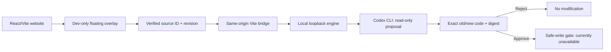

[SUMMON_FIXER_README.md](https://github.com/user-attachments/files/33903624/SUMMON_FIXER_README.md)
# Summon Fixer

### Point at a website element. Ask Codex for a change. Review the exact source-level proposal.

**A visual AI development companion for React + Vite websites.**

> **Hackathon submission — Developer Tools / Everyday Productivity** (also relevant to Local Business & Creator Tools)
>
> **Current MVP:** Real Codex-generated proposals, visual source selection, before/after review, Plan Only, and rejection have been demonstrated. **Automatic file application is not yet enabled:** approved edits fail closed with `SAFE_WRITE_UNAVAILABLE`.

## The problem

A creator or developer can see what needs fixing on a website—a button, form, cart, or layout—but still has to search through a codebase to find the right React component. AI chat can generate snippets, but it does not automatically connect **the element you clicked** to **the code responsible for it** or require you to review the exact edit.

## Our solution

**Summon Fixer brings a source-aware AI assistant directly into a running development website.**

1. **Point:** Activate the floating overlay or press **⌘⇧S** (macOS), then select a rendered element.
2. **Locate:** Development-only JSX instrumentation supplies an opaque source ID and revision, resolved and verified by the Vite bridge.
3. **Describe:** Ask naturally: “Make the cart quantity buttons update totals” or “Change Checkout Now to Buy Now.”
4. **Generate:** The local Codex CLI inspects the scoped workspace and proposes a structured source-code edit.
5. **Review:** See the original and replacement code, bound to a proposal version and digest. Choose Plan Only, Reject, or Approve.
6. **Stay in control:** Rejected proposals make no changes. **Approved proposals currently cannot be written** because the production safe-write gate deliberately refuses them.

**The long-term vision:** Editing a website should feel as direct as pointing at what you want to improve, without surrendering control of the code.

## What to capture for the hackathon

Include screenshots from a **real browser run** (not generated mockups):

- **Screenshot 1 — Select:** Aura Studio's Checkout Now button highlighted, with the `App.tsx` source-location badge visible.
- **Screenshot 2 — Ask:** Your natural-language request in Summon's floating panel.
- **Screenshot 3 — Real Codex:** Actual before/after proposal returned by the real model; do not use a screenshot marked `[FAKE RUNNER]` as AI proof.
- **Screenshot 4 — Review:** The Reject result, or the explicit `SAFE_WRITE_UNAVAILABLE` message shown after Approve.

**Screenshot links:** Add actual image files under `docs/screenshots/` and link them here after they have been committed. Don't add links to files that don't exist.

### Prepared editing scenarios

| Scenario | Request | What is currently demonstrated |
| --- | --- | --- |
| **Visual editing** | Change Checkout Now to Buy Now, purple background and rounded corners | Real Codex proposal and before/after review |
| **Functional editing** | Connect cart-drawer +/− buttons to quantity, badge and totals | Deliberately unconnected controls prepared for a code proposal |
| **Bug fixing** | Block invalid checkout email and show an accessible inline error | Deliberately missing validation prepared for a code proposal |

See [the exact demo prompts and acceptance checks](apps/demo/DEMO_SCENARIOS.md). The storefront is a **simulation**, not a connected payment processor. The requested cart and validation fixes are *not* already implemented.

## Architecture



| Package | Role |
| --- | --- |
| [`packages/overlay`](packages/overlay) | Browser selection, floating prompt, source review and approval/rejection UI |
| [`packages/vite-plugin`](packages/vite-plugin) | Development-only overlay injection, JSX source mapping, same-origin authenticated bridge |
| [`packages/runner`](packages/runner) | Local Codex runner, task lifecycle, output validation and safety checks |
| [`packages/contracts`](packages/contracts) | Shared Zod schemas, hashes, task/approval contracts and policy checks |
| [`packages/cli`](packages/cli) | Starts the engine and developer server |
| [`apps/demo`](apps/demo) | Aura Studio React storefront and three prepared editing scenarios |

**Tech:** TypeScript, React 19, Vite 8, Node.js 24+, Zod, Vitest, Codex CLI.

### Why this is different

- **Click-to-source mapping:** Instrumented DOM elements identify verified source locations instead of relying only on guesses from screenshots.
- **In-context development:** Select a rendered element and work in a floating development panel instead of hunting through files.
- **Review before action:** Model output must pass schema/source validation; the proposal is presented as explicit old/new source.
- **Human-controlled scope:** Manual and read-only modes; one existing-file update per proposal. Auto Apply and multi-file changes are not supported.
- **Protected local workflow:** Loopback-only engine, session-aware same-origin bridge, source revision checks and approval digest binding.

## Run locally

**Requirements:** Node.js >=24, npm >=10; for real model calls, an installed and authenticated Codex CLI with available usage. Use an unused local engine port and Vite port.

The working MVP is on **`integration/vertical-slice`**, not the repository's older default `main` branch.

```bash
git clone https://github.com/GODLIKEyp/Summon-Fixer-.git
cd Summon-Fixer-
git fetch origin
git switch --track origin/integration/vertical-slice
npm ci
npm run build
```

If that branch is already checked out, skip `git switch`.

### Option A — No model credits (fake runner)

```bash
npm run summon -- dev --fake --port 7890 \
  --command "npm run --workspace demo dev -- --host 127.0.0.1 --port 5185 --strictPort"
```

### Option B — Real Codex-generated proposals

```bash
codex --version
codex login status

CODEX_BIN_PATH="$(command -v codex)" npm run summon -- dev \
  --port 7890 --proposal-timeout-ms 120000 \
  --command "npm run --workspace demo dev -- --host 127.0.0.1 --port 5185 --strictPort"
```

Open **http://127.0.0.1:5185**. Use the floating launcher or **⌘⇧S**, select a page element, enter a prompt and review the proposal. **There must be no `--fake` argument for a real Codex demo.** The model comes from the local Codex CLI configuration; it is not hard-coded to a guaranteed GPT-6 entitlement. Real requests may consume usage and transmit authorized project context to the configured provider.

If either port is occupied, select an unused port; do not stop unrelated applications. Stop the running dev session with **Ctrl+C**.

## Verification

```bash
npm run build
npm run typecheck
SUMMON_RUN_REAL_CODEX_TESTS=0 npm test
npm audit
```

**Latest reported developer-run checks (October 24, 2026):** 223 model-free tests passed; two real-Codex tests intentionally skipped; build/typecheck passed; dependency audit reported zero vulnerabilities. These are **local verification results**, not a claim about hosted CI. A real Codex proposal, visible code review and rejection were separately observed in-browser.

## Verified scope and honest limitations

| Capability | Status |
| --- | --- |
| Dev-only overlay, element selection and source identification | Implemented and browser-tested |
| Real Codex source-edit proposals | Demonstrated in browser |
| Before/after review and Reject | Implemented and browser-tested |
| Plan Only | Implemented and browser-tested |
| Manual Approve | UI works, but approved writes **fail closed** |
| Automatically changing the source file | **Blocked: `SAFE_WRITE_UNAVAILABLE`** |
| Hot reload after an AI-applied file edit | **Not demonstrated** |
| Backend/database edits, multi-file edits, other frameworks | Not supported in the current MVP |

### Why does Approve not save the file?

An earlier writer could overwrite a concurrent save or be redirected through a swapped directory. Node/macOS pathname-based operations alone do not guarantee atomic, content-conditional replacement in the presence of independent editors. The current engine refuses the write instead of silently risking lost or redirected changes. See [the safe-write assessment](packages/runner/SAFE_WRITE_ASSESSMENT.md).

This is an **experimental proposal-and-review MVP**, not a production-ready autonomous code editor. A restricted demo-only writer may be explored separately in a disposable checkout, but it must not be confused with the present production behavior.

## Roadmap

1. Independently validated approved-file application under a documented concurrency model.
2. End-to-end visual confirmation of applied edits through Vite HMR.
3. Integrations for external React/Vite projects and additional frameworks.
4. Multi-file plans, test-aware verification and richer debugging workflows.

---

**Team:** Priyanshu & Suhani  
**Hackathon alignment:** Developer Tools / Everyday Productivity; helps creators and small businesses understand and improve their websites visually.

**Built around a clear principle: AI can propose a change, but the developer deserves to know exactly what is changing.**
