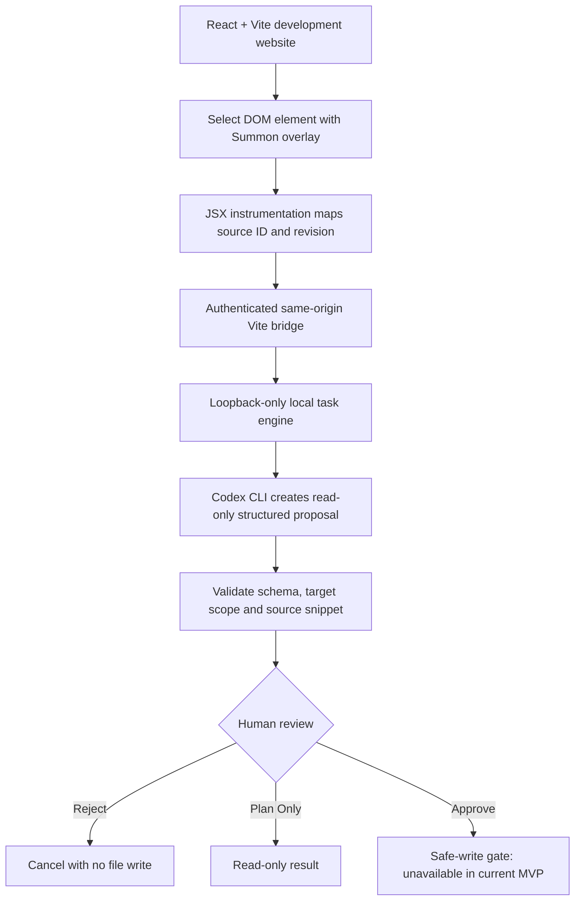

[README-4.md](https://github.com/user-attachments/files/33903789/README-4.md)
<div align="center">

# ⚡ Summon Fixer

### **Stop hunting for code. Start pointing at what you want to change.**

**A visual, source-aware AI companion for web developers and creators.**

[**The Problem**](#the-problem) · [**Live MVP**](#what-weve-built) · [**How It Works**](#from-a-click-to-a-code-proposal) · [**Future Vision**](#the-vision-beyond-the-mvp) · [**Run Locally**](#run-the-project)

</div>

> **Hackathon category:** Everyday Productivity / Developer Tools — also relevant to Local Business & Creator Tools.
>
> **What is genuinely working:** Select a website element → resolve its source → ask real Codex for a source edit → inspect the old/new code → reject or review the proposal.
>
> **Current boundary:** The production runner deliberately refuses approved file writes (`SAFE_WRITE_UNAVAILABLE`); auto-apply and resulting hot reload are **future capabilities, not shipped functionality**.

---

## Imagine this

You're building a site. A checkout button looks wrong. The cart total doesn't update. A form accepts an invalid email.

The problem is *right in front of you* — yet fixing it sends you on a scavenger hunt through components, styles, event handlers and files.

**What if your website was the interface to your codebase?**

Click the broken element, describe what should happen, and review an AI-generated source change **in context**. That is the experience we're building with Summon Fixer.

## The problem

For independent developers, creators and small-business teams, even small website edits create friction:

- **The visual-to-code gap:** The element is easy to find on screen, but its owning component is not.
- **Context switching:** Browser → editor → file search → AI chat → back to browser.
- **Generic AI suggestions:** A snippet can be plausible without matching the selected element or the actual project.
- **Unclear control:** Accepting an AI edit should mean approving a specific, inspectable change — not granting unlimited write access.

## What we've built

### A real React/Vite website with a local visual AI overlay

The working demo is an **Aura Studio** e-commerce-style storefront. It gives Summon a realistic UI with buttons, cart controls and checkout interactions. Payment is simulated; there is no real payment processor.


<sub>**Actual application screenshot.** Aura Studio is the demonstration host, not a conceptual UI render.</sub>

### 01 / Point at the element

Activate Summon from its floating launcher or press **⌘⇧S** on macOS. Hover over and select a visible UI element; the dev-time instrumentation links it to a file and location.


<sub>**Actual screenshot:** a rendered checkout button selected with its `App.tsx` source position.</sub>

### 02 / Describe the change in plain English

A lightweight overlay shows the selected element, its verified source badge, and the instruction field. Choose **Manual Approval** or **Plan Only**.


<sub>**Actual screenshot:** the development overlay; this image does not claim a successful AI write.</sub>

### 03 / Get a source-level Codex proposal

Instead of guessing from pixels, Summon sends a scoped task to a local **OpenAI Codex CLI** process. The runner asks for structured old/new source content. The proposal is checked against a schema, existing-file scope, and exact source snippets.

In our local browser test, **real Codex generated a code proposal and the reviewer rejected it successfully**. This is distinct from the repository's deterministic `--fake` test runner. We do not present fake-runner captures as evidence of real AI generation.

### 04 / Review before acting

The developer can inspect the proposed changes, read the source-level before/after content, and reject them. The implementation also binds approvals to a version and proposal digest. The user remains in charge of what was *proposed*.

**Important:** The current approval endpoint **does not write to disk**, even if a user chooses Approve. It fails closed rather than claiming an unverified safe replacement. A secure, verified writer is on the roadmap.

---

## From a click to a code proposal



**Why this architecture matters:** Browser selections are untrusted. The server resolves source identities and retains authority over workspace scope, while the model proposes rather than edits files directly.

### Built with

| Layer | Technology | What it does |
|:--|:--|:--|
| Frontend | **React 19, TypeScript, Vite 8** | Running storefront and development surface |
| Visual companion | **Shadow DOM-based overlay** | Selection, inline task prompts and review UI |
| Source intelligence | **JSX/TSX instrumentation + Vite registry** | Maps DOM elements to verified source IDs and revisions |
| Local bridge | **Vite middleware** | Session-aware, same-origin requests to the engine |
| Task engine | **Node.js, TypeScript, Zod** | Enforces proposal, path and approval boundaries |
| AI generation | **OpenAI Codex CLI** | Produces structured source-edit proposals |
| Reliability | **Vitest, TypeScript checks** | Unit and integration regressions |

### Repository layout

```text
apps/demo/             Aura Studio storefront and scenario fixtures
packages/overlay/      Floating UI, point mode and review panel
packages/vite-plugin/  Dev-only injection, source mapping and secure bridge
packages/runner/       Codex proposal runner and task lifecycle
packages/contracts/    Shared types, Zod schemas and approval digests
packages/cli/          Local engine + Vite process launcher
```

## Three demo stories, one product

We prepared three realistic tasks on the demo storefront. The UI defects are deliberately present so they can be used to evaluate AI **proposals**; the requested fixes are not pre-implemented.

| Scenario | User's request | What it demonstrates |
|:--|:--|:--|
| **Visual design** | *“Turn Checkout Now into Buy Now and make it purple.”* | Selection-to-source + scoped UI-edit proposal |
| **Functional logic** | *“Make the cart + and − buttons update quantities, totals and tax.”* | A request for a behavioral React fix, not only styling |
| **Validation** | *“Reject invalid checkout email and show an accessible error.”* | A request involving form behavior and user feedback |

See [demo scenarios, prompts and acceptance criteria](apps/demo/DEMO_SCENARIOS.md).

---

## The vision: beyond the MVP

**The endgame is not another chat box in the developer workflow. It's a new way to interact with software.**

Our vision is a context-aware visual companion that understands *which* element you mean, traces *why* it behaves that way, proposes changes across relevant code, lets you choose the level of control, verifies the result, and gives you a working application back.

### Concept storyboard · future experience


> **ARTWORK / FUTURE PRODUCT VISION — NOT A CURRENT PRODUCT SCREENSHOT.** This generated storyboard illustrates the proposed end-to-end journey, including successful approved file application and immediate hot reload. **Those last two steps are not available in the present implementation.** The accurate MVP status appears [below](#transparent-feature-status).

### Our north-star experience

1. **Point** — select anything in a running interface, not only a component name.
2. **Understand** — find the component, state and relevant behavior behind that selection.
3. **Ask** — describe the goal naturally, without opening a maze of files.
4. **Plan** — understand the impact and see exactly what would change.
5. **Approve** — choose manual approval, read-only planning, or eventually narrowly scoped automatic execution.
6. **Verify** — run checks, confirm the behavior and see the improvement in the actual app.

### The future we want to unlock

- **For creators:** adjust a landing page, fix a signup form, or update a portfolio without digging through frontend files.
- **For small businesses:** maintain storefronts and booking flows with clearer visibility into proposed changes.
- **For developers:** reduce context switching while retaining test, security and Git review boundaries.
- **For teams:** bring a source-aware assistant into additional frameworks, full-stack services and eventually supported desktop interfaces.

These are **product directions**, not claims that the current MVP already supports non-Vite apps, backend editing or autonomous desktop control.

---

## Run the project

The tested integration is on **[`integration/vertical-slice`](https://github.com/GODLIKEyp/Summon-Fixer-/tree/integration/vertical-slice)**. The default `main` branch is an earlier foundation and should not be used as the finished hackathon reference.

### Prerequisites

- Node.js **24+**, npm **10+**
- For real AI: installed Codex CLI, signed-in account and available Codex usage
- Two available loopback ports (examples below: 7890 and 5185)

```bash
git clone --single-branch --branch integration/vertical-slice   https://github.com/GODLIKEyp/Summon-Fixer-.git
cd Summon-Fixer-
npm ci
npm run build
```

### Option A — Local deterministic demo (no model calls)

```bash
npm run summon -- dev --fake --port 7890   --command "npm run --workspace demo dev -- --host 127.0.0.1 --port 5185 --strictPort"
```

The `--fake` mode is for testing the browser pipeline. Its outputs are **not Codex-generated proposals**.

### Option B — Real Codex proposal generation

```bash
codex --version
codex login status

CODEX_BIN_PATH="$(command -v codex)" npm run summon -- dev   --port 7890   --proposal-timeout-ms 120000   --command "npm run --workspace demo dev -- --host 127.0.0.1 --port 5185 --strictPort"
```

Open **http://127.0.0.1:5185**. Activate Summon, select a page element, submit a prompt, and inspect its source proposal. **Do not include `--fake` for real model use.** The selected Codex model comes from the developer's local CLI configuration, not a guarantee about account entitlements. Authorized project context may be sent to the configured model provider and consume usage.

> If ports are already occupied, choose unused ports instead of stopping other work. The app and engine should remain loopback-only. Stop the demo with **Ctrl+C**.

### Verify

```bash
npm run build
npm run typecheck
SUMMON_RUN_REAL_CODEX_TESTS=0 npm test
npm audit
```

**Reported local verification (24 October 2026):** 223 model-free tests passed, two real-Codex tests skipped, build/typecheck passed and npm audit reported zero vulnerabilities. These are developer-run results, not a claim of a passing remote CI badge. Real Codex proposal review and rejection were also observed in a browser session.

## Transparent feature status

| Functionality | Current state |
|:--|:--|
| Floating overlay in a running React/Vite dev page | ✅ Implemented / browser-tested |
| Select a DOM element and resolve its source file | ✅ Implemented / browser-tested |
| Generate an edit proposal through real Codex CLI | ✅ Observed in a local browser run |
| Inspect original/replacement code | ✅ Observed in a local browser run |
| Read-only Plan Only and Reject | ✅ Implemented / tested |
| Explicit approval and proposal digest validation | ✅ Implemented, **but cannot write** |
| Save approved change to disk | ⛔ Intentionally blocked (`SAFE_WRITE_UNAVAILABLE`) |
| Apply → Vite HMR → verified website change | 🧭 Vision / not yet demonstrated |
| Automatic approval, multi-file edits, backend or desktop editing | 🧭 Beyond current MVP |

### Why does the writer fail closed?

The existing approval pipeline checks target path containment, source snippets, content preconditions, and digests. But ordinary macOS/Node filesystem operations do not guarantee a content-conditional replacement against independent writers and parent-directory swaps. Rather than silently risking overwritten or redirected source, the current runtime refuses the operation. Read the documented [safe-write assessment](packages/runner/SAFE_WRITE_ASSESSMENT.md) for details.

**This is a proposal-and-review MVP, not an autonomous code editor.** A future write mode must adopt a carefully documented safety and concurrency model, ideally demonstrated in a disposable checkout before being offered in ordinary projects.

## Why this matters

**Our insight:** the hard part is often not generating code. It is connecting what a user sees to the exact code they intend to change, keeping the request scoped, and making the result understandable enough to trust.

Summon Fixer explores that middle layer: **visual intent → verified source context → AI proposal → human decision**.

### Next milestones

- A restricted, reviewed application mechanism with honest concurrency guarantees
- Verified file changes and Vite hot-reload acceptance in an isolated checkout
- Broader framework and project onboarding beyond the built-in demo
- Test-aware changes, authenticated review history and richer multi-file workflows

---

<div align="center">

**Built by Priyanshu & Suhani**

*For developers, creators and businesses who want to change what they see — without losing control of what changes.*

**Real screenshots show current behavior. Generated concept artwork shows our vision. We never use a mockup as proof of a shipped feature.**

</div>
